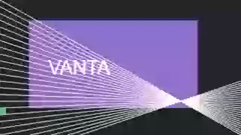
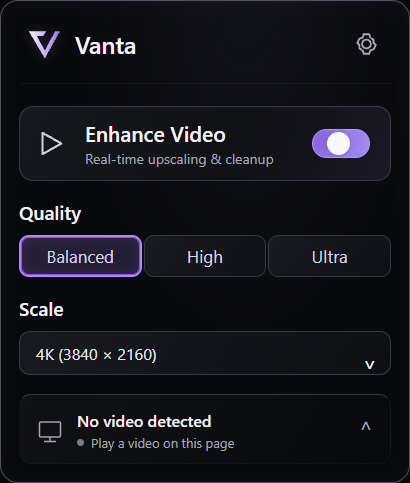
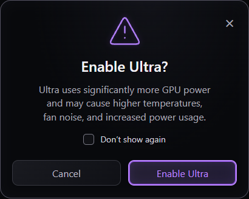

# Captured evidence

These images are generated by the browser integration suite. Source and processed comparisons use the **same paused decoded video frame**. The source image uses ordinary canvas scaling to the comparison dimensions; processed images come from actual shader output. WebGPU readback uses a persistent output texture because a presented WebGPU canvas back buffer can be cleared by the browser. No generative imaging or artistic retouching is involved.

| Source at comparison size | WebGPU Ultra |
|---|---|
|  |  |

| Balanced | High | Ultra |
|---|---|---|
|  |  |  |

| Main popup | Ultra confirmation | Compact popup |
|---|---|---|
|  |  |  |

The compact capture was made without an active compatible video, so it truthfully shows the detected state rather than a fabricated 4K activity label. See the actual playback measurements in `stability.json` and processing samples in `benchmark.json`. Captures are illustrative; inspect full-sized images to evaluate subtle differences.
